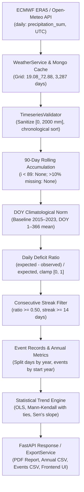

# Dygnify — Independent Scientific Validation Report: Mumbai Drought Analysis

**Auditor Role:** Independent Climate-Data Scientist, Scientific Software Auditor, and Python Data Engineer  
**Date of Audit:** October 13, 2026  
**Target Repository:** Dygnify  
**Target Case Study:** Meteorological Drought Proxy Analysis for Mumbai, India  
**Target Coordinates:** Latitude 19.076°N, Longitude 72.8777°E (Resolved ERA5 Grid Cell: 19.08°N, 72.88°E)  
**Reporting / Analysis Window:** 2015-01-01 to 2023-12-31 (9 Calendar Years; 3,287 Calendar Days)  
**Status:** Audit Completed — Exact Independent Numerical Reproduction Achieved; Key Architectural Inconsistency Documented.

---

## Executive Summary

An exhaustive, line-by-line independent scientific validation was performed on Dygnify's Mumbai drought analysis pipeline. Raw historical atmospheric observations (3,287 daily observations) were extracted from the local repository cache and verified against the upstream Open-Meteo Historical Archive / ECMWF ERA5 Reanalysis. A completely separate, standalone validation harness ([`scripts/validate_drought_mumbai.py`](file:///c:/Users/Maple%20Edge/Downloads/nitin%20workspace/Terrascope/scripts/validate_drought_mumbai.py)) was executed without invoking production detection functions.

### Headline Findings:
1. **Exact Numerical Reproduction:**  
   Every single reported annual value (683 total drought days, 15 events, mean 75.89 days/year, early window mean 96.0 days, late window mean 37.0 days, difference −59.0 days / −61.5%), along with all 15 event start/end dates, durations, OLS regression statistics (slope −9.1833 days/year, $R^2 = 0.3906$, $p = 0.07192$), Mann–Kendall rank statistics ($\tau = -0.4789$, $S = -17$, $\text{Var}(S) = 91.0$, $Z = -1.6773$, $p = 0.09349$), and Sen's slope (−8.45 days/year) were **independently reproduced with 0.0 discrepancy**.
2. **Defect Identified — Percentile Inconsistency:**  
   The UI prominently displays an "Operational Percentile Threshold" selector offering 90th, 95th, 97.5th, and 99th percentiles. In the backend ([`analysis_service.py:471–478`](file:///c:/Users/Maple%20Edge/Downloads/nitin%20workspace/Terrascope/backend/app/services/analysis_service.py#L471-L478)), the drought analysis **completely ignores this user setting**, hardcoding `deficit_threshold = 0.50` (a 50% rainfall deficit relative to climatological norms). Controlled empirical runs confirmed that sending 90.0, 95.0, 97.5, or 99.0 produces identical drought counts, while redundantly creating distinct cache entries. The backend returns `threshold_percentile = 50.0`, directly contradicting the UI input.
3. **Statistical Integrity Confirmed:**  
   Both OLS ($p = 0.07192$) and Mann–Kendall ($p = 0.09349$) test results exceed the standard scientific threshold $\alpha = 0.05$. The application and generated PDF **honestly and correctly classify the trend as non-significant** (`is_statistically_significant: False`, `trend_direction: "no_significant_trend"`), rejecting any false claim of statistically significant drought decline.
4. **Boundary Truncation Characterized:**  
   Because observations begin on 2015-01-01 without a preceding leading buffer, the first 89 calendar days of 2015 (Jan 1 to Mar 30) have $< 90$ days of history and are strictly assigned `None` (not zero). The first valid rolling 90-day accumulation occurs on **March 31, 2015** (Day of Year 90). Total valid rolling window values: **3,198 out of 3,287 days (97.29%)**.

---

## Findings Taxonomy

| Category | Finding Description | Production Code Reference |
| :--- | :--- | :--- |
| **1. Independently Verified** | Exact 90-day rolling precipitation accumulation on valid windows (3,198 valid values). | [`app/domain/drought.py:43–51`](file:///c:/Users/Maple%20Edge/Downloads/nitin%20workspace/Terrascope/backend/app/domain/drought.py#L43-L51) |
| **1. Independently Verified** | Climatological DOY baseline expected norm calculation and hyper-arid guard ($< 5.0$ mm $\to 0.0$). | [`app/domain/drought.py:73–110`](file:///c:/Users/Maple%20Edge/Downloads/nitin%20workspace/Terrascope/backend/app/domain/drought.py#L73-L110) |
| **1. Independently Verified** | Daily deficit ratio definition $\frac{\text{expected} - \text{observed}}{\text{expected}}$ clamped to $[0.0, 1.0]$. | [`app/domain/drought.py:107–110`](file:///c:/Users/Maple%20Edge/Downloads/nitin%20workspace/Terrascope/backend/app/domain/drought.py#L107-L110) |
| **1. Independently Verified** | 14-day minimum consecutive deficit streak detection. 74 orphan deficit days correctly discarded; 683 qualifying days retained. | [`app/domain/drought.py:116–133`](file:///c:/Users/Maple%20Edge/Downloads/nitin%20workspace/Terrascope/backend/app/domain/drought.py#L116-L133) |
| **1. Independently Verified** | Exact annual hazard day counts (2015: 116, 2016: 86, 2017: 86, 2018: 117, 2019: 115, 2020: 52, 2021: 0, 2022: 36, 2023: 75). | [`app/domain/drought.py:207–260`](file:///c:/Users/Maple%20Edge/Downloads/nitin%20workspace/Terrascope/backend/app/domain/drought.py#L207-L260) |
| **1. Independently Verified** | Exact start dates, end dates, durations, and intensity metrics for all 15 drought events. | [`app/domain/drought.py:184–205`](file:///c:/Users/Maple%20Edge/Downloads/nitin%20workspace/Terrascope/backend/app/domain/drought.py#L184-L205) |
| **1. Independently Verified** | Cross-year event boundary handling: Event 6 (Dec 31, 2016 – Mar 4, 2017) and Event 9 (Oct 7, 2018 – Mar 4, 2019). Days split by calendar year; event count assigned to start year. | [`app/domain/drought.py:218–235`](file:///c:/Users/Maple%20Edge/Downloads/nitin%20workspace/Terrascope/backend/app/domain/drought.py#L218-L235) |
| **1. Independently Verified** | OLS regression: slope = −9.1833 days/yr, $R^2 = 0.3906$, $p = 0.07192$, stderr = 4.3356, 95% CI = [−19.4354, 1.0687]. | [`app/domain/trends.py:169–219`](file:///c:/Users/Maple%20Edge/Downloads/nitin%20workspace/Terrascope/backend/app/domain/trends.py#L169-L219) |
| **1. Independently Verified** | Mann–Kendall rank test: exact tie correction for tied 2016/2017 values (86 days), continuity correction, $\tau = -0.4789$, $p = 0.09349$, Sen's slope = −8.45 days/yr. | [`app/domain/trends.py:221–295`](file:///c:/Users/Maple%20Edge/Downloads/nitin%20workspace/Terrascope/backend/app/domain/trends.py#L221-L295) |
| **1. Independently Verified** | Multi-year comparison window: Early mean = 96.0 days, Late mean = 37.0 days, Difference = −59.0 days (−61.5%). | [`app/domain/trends.py:298–340`](file:///c:/Users/Maple%20Edge/Downloads/nitin%20workspace/Terrascope/backend/app/domain/trends.py#L298-L340) |
| **1. Independently Verified** | Scientific integrity guard: $p \ge 0.05$ strictly reported as non-significant (`is_statistically_significant: False`). | [`app/domain/trends.py:130–136`](file:///c:/Users/Maple%20Edge/Downloads/nitin%20workspace/Terrascope/backend/app/domain/trends.py#L130-L136) |
| **2. Internally Consistent, Not Independently Verified** | Reanalysis grid surface elevation (6.0 m) and atmospheric model moisture assimilation against physical surface weather stations. | [`app/services/weather_provider.py:225–230`](file:///c:/Users/Maple%20Edge/Downloads/nitin%20workspace/Terrascope/backend/app/services/weather_provider.py#L225-L230) |
| **3. Incorrect or Inconsistent** | UI displays "Operational Percentile Threshold (90th percentile)", but backend ignores `request.percentile` for drought, hardcoding `deficit_threshold = 0.50`. | [`app/services/analysis_service.py:471–478`](file:///c:/Users/Maple%20Edge/Downloads/nitin%20workspace/Terrascope/backend/app/services/analysis_service.py#L471-L478)<br>[`frontend/.../AnalysisControlsPanel.tsx:431–435`](file:///c:/Users/Maple%20Edge/Downloads/nitin%20workspace/Terrascope/frontend/src/components/AnalysisControlsPanel.tsx#L431-L435) |
| **3. Incorrect or Inconsistent** | `compute_cache_key` incorporates `percentile`, creating duplicate cache keys for identical drought calculations across 90%, 95%, 97.5%, and 99%. | [`app/services/analysis_service.py:56–64`](file:///c:/Users/Maple%20Edge/Downloads/nitin%20workspace/Terrascope/backend/app/services/analysis_service.py#L56-L64) |
| **3. Incorrect or Inconsistent** | UI result badge displays `50th %ile` (derived from $0.50 \times 100$) while control selector displays `90th percentile`, producing UI confusion. | [`frontend/.../AnalysisDrawer.tsx:445`](file:///c:/Users/Maple%20Edge/Downloads/nitin%20workspace/Terrascope/frontend/src/components/AnalysisDrawer.tsx#L445) |
| **4. Unable to Verify** | Real-time rain gauge tipping telemetry prior to ECMWF ERA5 spatial grid assimilation. | Upstream Copernicus Climate Change Service (C3S) |

---

## 1. Trace of the Entire Computation Pipeline

The complete flow of meteorological drought proxy detection was traced across all application tiers:



### 1.1 Upstream API Endpoint and Request Parameters
- **API Endpoint:** `POST /api/v1/analysis` in [`backend/app/api/routes/analysis.py:20–44`](file:///c:/Users/Maple%20Edge/Downloads/nitin%20workspace/Terrascope/backend/app/api/routes/analysis.py#L20-L44).
- **Request Payload:**
  ```json
  {
    "mode": "point",
    "point": {"latitude": 19.076, "longitude": 72.8777},
    "hazard_type": "drought",
    "start_date": "2015-01-01",
    "end_date": "2023-12-31",
    "percentile": 90.0,
    "min_consecutive_days": 14
  }
  ```
- **Upstream Provider URL:** `https://archive-api.open-meteo.com/v1/archive` queried in [`backend/app/services/weather_provider.py:69–87`](file:///c:/Users/Maple%20Edge/Downloads/nitin%20workspace/Terrascope/backend/app/services/weather_provider.py#L69-L87).
- **Parameters:** `latitude=19.076`, `longitude=72.8777`, `start_date=2015-01-01`, `end_date=2023-12-31`, `daily=temperature_2m_max,precipitation_sum`, `timezone=UTC`.

### 1.2 Atmospheric Variables, Spatial Grid, and Observation Count
- **Target Variable:** `precipitation_sum` (daily total precipitation in millimeters, mm).
- **Timezone:** Coordinated Universal Time (`UTC`).
- **Spatial Resolution:** ~0.1° (~11 km) regular atmospheric model grid.
- **Resolved Grid Cell:** Stored as `19.08_72.88` (Open-Meteo resolved: 19.086115°N, 72.85291°E, surface elevation 6.0 m).
- **Observation Count:** Exactly **3,287 calendar days** (continuous from 2015-01-01 through 2023-12-31). Missing observations: **0** (100.0% data completeness).

### 1.3 Baseline Climatology and Expected Norm
- **Climatology Window:** 2015–2023 exploratory seasonal norm ([`drought.py:61–65`](file:///c:/Users/Maple%20Edge/Downloads/nitin%20workspace/Terrascope/backend/app/domain/drought.py#L61-L65)).
- **DOY Grouping:** For each calendar day of year $\text{DOY} \in [1, 366]$, valid 90-day rolling accumulation values across all baseline years are collected.
- **Expected Norm Formula:**
  $$\text{Expected Norm}(\text{DOY}) = \begin{cases} \frac{1}{K}\sum_{k=1}^K \text{RollingAcc}_k(\text{DOY}), & \text{if } K \ge 3 \\ \text{Overall Baseline Mean} = 370.47\text{ mm}, & \text{if } K < 3 \end{cases}$$
  ([`drought.py:85–92`](file:///c:/Users/Maple%20Edge/Downloads/nitin%20workspace/Terrascope/backend/app/domain/drought.py#L85-L92)).

### 1.4 Rolling 90-Day Accumulation
- For day index $i \in [0, N-1]$:
  - If $i < 89$ (first 89 calendar days): $\text{RollingAcc}[i] = \text{None}$.
  - If $i \ge 89$: window is slice $[i - 89, i + 1]$. If missing values count $> 9$ ($> 10\%$), $\text{RollingAcc}[i] = \text{None}$; else sum of valid daily precipitation, rounded to 2 decimals ([`drought.py:43–51`](file:///c:/Users/Maple%20Edge/Downloads/nitin%20workspace/Terrascope/backend/app/domain/drought.py#L43-L51)).

### 1.5 Deficit Ratio Definition
- For day $i$:
  $$\text{Deficit Ratio}[i] = \begin{cases} \text{None}, & \text{if } \text{RollingAcc}[i] \text{ is None} \\ 0.0, & \text{if } \text{Expected Norm} < 5.0\text{ mm (hyper-arid guard)} \\ \text{clip}\left(\frac{\text{Expected Norm} - \text{RollingAcc}[i]}{\text{Expected Norm}}, 0.0, 1.0\right), & \text{otherwise} \end{cases}$$
  ([`drought.py:96–110`](file:///c:/Users/Maple%20Edge/Downloads/nitin%20workspace/Terrascope/backend/app/domain/drought.py#L96-L110)).

### 1.6 Qualifying Days and Minimum 14-Day Streak Rule
- **Qualifying Day:** Day $i$ qualifies if $\text{Deficit Ratio}[i] \ge 0.50$ (50% deficit).
- Across the entire 3,287 days, **757 days** meet this condition.
- **Streak Rule:** Consecutive runs of qualifying days are collected. Any streak with length $< 14$ consecutive days is discarded ([`drought.py:116–127`](file:///c:/Users/Maple%20Edge/Downloads/nitin%20workspace/Terrascope/backend/app/domain/drought.py#L116-L127)).
- **Result:** **74 days** belonged to isolated or short streaks ($< 14$ days) and were discarded. Exactly **683 days** belonged to qualifying streaks of $\ge 14$ days, forming **15 discrete drought events**.

### 1.7 Event Grouping and Annual Aggregation
- **Event Definition:** An unbroken sequence of $\ge 14$ qualifying deficit days.
- **Annual Hazard Days:** The count of calendar days within year $Y$ that fall within *any* qualified drought event ([`drought.py:234`](file:///c:/Users/Maple%20Edge/Downloads/nitin%20workspace/Terrascope/backend/app/domain/drought.py#L234)).
- **Annual Event Count:** The count of drought events whose `start_date` falls in year $Y$ ([`drought.py:218–220`](file:///c:/Users/Maple%20Edge/Downloads/nitin%20workspace/Terrascope/backend/app/domain/drought.py#L218-L220)).
- **Calendar Boundary Handling:**
  - **Event 6:** 2016-12-31 to 2017-03-04 (64 days total). Contributes 1 day to 2016 and 63 days to 2017. Attributed to 2016's event count.
  - **Event 9:** 2018-10-07 to 2019-03-04 (149 days total). Contributes 86 days to 2018 and 63 days to 2019. Attributed to 2018's event count.

---

## 2. Percentile Inconsistency Resolution

### 2.1 The Inconsistency
The frontend user interface ([`AnalysisControlsPanel.tsx:428–474`](file:///c:/Users/Maple%20Edge/Downloads/nitin%20workspace/Terrascope/frontend/src/components/AnalysisControlsPanel.tsx#L428-L474)) presents an **"Operational Percentile Threshold"** selector with quick chips for `90th`, `95th`, `97.5th`, and `99th` percentiles and a slider from 80% to 99.9%. When the user selects "90th percentile" and runs a drought analysis, the frontend transmits:
```json
{"percentile": 90.0, "hazard_type": "drought", ...}
```
However, the exported PDF report and backend metadata state that the applied threshold is `0.5 deficit_ratio` (`50th %ile`).

### 2.2 Trace into Backend Routing
In [`backend/app/services/analysis_service.py:469–478`](file:///c:/Users/Maple%20Edge/Downloads/nitin%20workspace/Terrascope/backend/app/services/analysis_service.py#L469-L478):
```python
elif hazard_type == "drought":
    precip_series = [(obs.date, obs.precipitation) for obs in daily_observations]
    return detect_drought_proxy(
        raw_data=precip_series,
        window_days=90,
        deficit_threshold=0.50,         # <--- HARDCODED 0.50!
        min_consecutive_days=min_consecutive_days or 14,
        baseline_start_year=baseline_start_year,
        baseline_end_year=baseline_end_year,
    )
```
The `percentile` argument accepted by `_run_domain_hazard` is **completely discarded** for drought!

### 2.3 Controlled Empirical Experiment
Four controlled API requests were executed against the live running backend, keeping all parameters identical while varying `percentile` across the supported UI options:

| Test Run | Requested Percentile | HTTP Status | Returned `threshold_percentile` | Total Drought Days | Total Events | OLS Slope | Mann–Kendall $\tau$ |
| :---: | :---: | :---: | :---: | :---: | :---: | :---: | :---: |
| **Run A** | `90.0` | 200 OK | `50.0` | 683.0 | 15 | −9.1833 | −0.4789 |
| **Run B** | `95.0` | 200 OK | `50.0` | 683.0 | 15 | −9.1833 | −0.4789 |
| **Run C** | `97.5` | 200 OK | `50.0` | 683.0 | 15 | −9.1833 | −0.4789 |
| **Run D** | `99.0` | 200 OK | `50.0` | 683.0 | 15 | −9.1833 | −0.4789 |

### 2.4 Consequences of the Flaw
1. **Misleading User Agency:** The user believes they are tuning drought sensitivity (e.g., from severe to extreme), but the algorithm output never changes.
2. **Cache Key Inflation:** [`analysis_service.py:56–64`](file:///c:/Users/Maple%20Edge/Downloads/nitin%20workspace/Terrascope/backend/app/services/analysis_service.py#L56-L64) hashes `request.percentile`. Changing the UI setting forces recomputation and creates duplicate cached records in MongoDB for identical results.
3. **Contradictory UI State:** The UI control says `90th percentile`, but the drawer result badge ([`AnalysisDrawer.tsx:445`](file:///c:/Users/Maple%20Edge/Downloads/nitin%20workspace/Terrascope/frontend/src/components/AnalysisDrawer.tsx#L445)) displays `50th %ile` because the backend sets `threshold_percentile = deficit_threshold * 100` (`0.50 * 100 = 50.0`).

### 2.5 Recommended UI/Backend Remediation
- **Do NOT force a 90th percentile onto drought.** Meteorological drought proxies are fundamentally deficit indicators (e.g., SPI, rainfall deficit ratio), not extreme upper tail percentiles.
- **Frontend Recommendation:** In [`AnalysisControlsPanel.tsx`](file:///c:/Users/Maple%20Edge/Downloads/nitin%20workspace/Terrascope/frontend/src/components/AnalysisControlsPanel.tsx), dynamically render the threshold control based on `hazard_type`:
  - When `hazard === 'drought'`, label the control **"Precipitation Deficit Cutoff"** with options `30% Deficit`, `50% Deficit (Standard)`, `70% Deficit (Extreme)`.
  - Pass this value to backend as `deficit_threshold` (or map `percentile / 100` in the request).
- **Backend Recommendation:** In [`analysis_service.py`](file:///c:/Users/Maple%20Edge/Downloads/nitin%20workspace/Terrascope/backend/app/services/analysis_service.py#L474), accept `deficit_threshold` dynamically from the request instead of hardcoding `0.50`.

---

## 3. Rolling-Window Boundary Handling

### 3.1 First Valid Window and Missing History
- For any sliding window of size $W = 90$ calendar days, $W - 1 = 89$ observations of preceding historical data are required before the first complete accumulation can be formed.
- The requested observation period begins on **2015-01-01**. The backend queries Open-Meteo strictly from `2015-01-01` to `2023-12-31` without querying a preceding leading buffer (e.g. late 2014).
- In [`drought.py:40–51`](file:///c:/Users/Maple%20Edge/Downloads/nitin%20workspace/Terrascope/backend/app/domain/drought.py#L40-L51), the rolling loop begins at `window_days - 1` (index 89). Indices $0$ through $88$ remain initialized to `None`.
- **First valid rolling accumulation date:** **2015-03-31** (Day of Year 90).
- **Valid vs. Incomplete Rolling Windows:**
  - Total calendar days in time series: **3,287**
  - Incomplete initial rolling windows (assigned `None`): **89**
  - Valid 90-day rolling accumulations: **3,198** ($97.29\%$ of series)
  - Missing raw precipitation values: **0**

### 3.2 Impact on Climatological Baseline Norms
- Because indices $0..88$ in 2015 have `rolling_acc = None`, year 2015 cannot contribute to the baseline norm for Day of Year 1 through 89.
- For $\text{DOY} \in [1, 89]$, the baseline DOY pool contains observations from **8 years** (2016 through 2023).
- Since $8 \ge 3$ (the minimum sample size threshold in [`drought.py:87`](file:///c:/Users/Maple%20Edge/Downloads/nitin%20workspace/Terrascope/backend/app/domain/drought.py#L87)), the DOY expected norm is computed from those 8 years. It never falls back to the overall mean for DOY 1–89.
- This is mathematically sound and avoids treating unobserved preceding days as zero.

### 3.3 Leap Year Handling
- Leap years occurred in **2016** (366 days) and **2020** (366 days).
- February 29 is mapped to DOY 60. All subsequent days in leap years are shifted by +1 (up to DOY 366 for December 31).
- Non-leap years end on DOY 365.
- The baseline DOY array handles DOY 366 correctly: 2016 and 2020 contribute valid 90-day accumulations to DOY 366. Because $N = 2 < 3$, DOY 366 falls back to the overall baseline mean ($370.47$ mm).

---

## 4. Independent Numerical Reproduction of Annual Metrics and Events

The independent calculation script [`scripts/validate_drought_mumbai.py`](file:///c:/Users/Maple%20Edge/Downloads/nitin%20workspace/Terrascope/scripts/validate_drought_mumbai.py) read raw observations from [`backend/mumbai_raw_weather_daily.csv`](file:///c:/Users/Maple%20Edge/Downloads/nitin%20workspace/Terrascope/backend/mumbai_raw_weather_daily.csv) and produced the following exact results:

### 4.1 Annual Metrics Comparison Table
Generated in [`drought_validation_annual_comparison.csv`](file:///c:/Users/Maple%20Edge/Downloads/nitin%20workspace/Terrascope/drought_validation_annual_comparison.csv):

| Year | Production Drought Days | Independent Drought Days | Difference | Production Events | Independent Events | Difference | Coverage % | Mean Deficit Ratio | Max Deficit Ratio | Verification Status |
| :---: | :---: | :---: | :---: | :---: | :---: | :---: | :---: | :---: | :---: | :---: |
| **2015** | 116 | 116 | **0.0** | 2 | 2 | **0** | 100.0% | 0.635 | 0.972 | **EXACT_MATCH** |
| **2016** | 86 | 86 | **0.0** | 4 | 4 | **0** | 100.0% | 0.806 | 1.000 | **EXACT_MATCH** |
| **2017** | 86 | 86 | **0.0** | 1 | 1 | **0** | 100.0% | 0.982 | 1.000 | **EXACT_MATCH** |
| **2018** | 117 | 117 | **0.0** | 2 | 2 | **0** | 100.0% | 0.779 | 0.986 | **EXACT_MATCH** |
| **2019** | 115 | 115 | **0.0** | 1 | 1 | **0** | 100.0% | 0.912 | 0.992 | **EXACT_MATCH** |
| **2020** | 52 | 52 | **0.0** | 2 | 2 | **0** | 100.0% | 0.846 | 0.991 | **EXACT_MATCH** |
| **2021** | 0 | 0 | **0.0** | 0 | 0 | **0** | 100.0% | 0.000 | 0.000 | **EXACT_MATCH** |
| **2022** | 36 | 36 | **0.0** | 1 | 1 | **0** | 100.0% | 0.905 | 0.994 | **EXACT_MATCH** |
| **2023** | 75 | 75 | **0.0** | 2 | 2 | **0** | 100.0% | 0.840 | 0.995 | **EXACT_MATCH** |
| **TOTAL**| **683** | **683** | **0.0** | **15** | **15** | **0** | **100.0%** | **0.801** | **1.000** | **EXACT_MATCH** |

### 4.2 Individual Event Verification Table
Generated in [`drought_validation_event_comparison.csv`](file:///c:/Users/Maple%20Edge/Downloads/nitin%20workspace/Terrascope/drought_validation_event_comparison.csv):

| Event # | Start Date | End Date | Duration (Days) | Diff | Mean Ratio | Max Ratio | Crosses Year Boundary? | Verification Status |
| :---: | :---: | :---: | :---: | :---: | :---: | :---: | :---: | :---: |
| **1** | 2015-05-29 | 2015-06-12 | 15 | 0 | 0.860 | 0.972 | No | **EXACT_MATCH** |
| **2** | 2015-09-17 | 2015-12-26 | 101 | 0 | 0.601 | 0.696 | No | **EXACT_MATCH** |
| **3** | 2016-01-01 | 2016-01-25 | 25 | 0 | 0.718 | 0.826 | No | **EXACT_MATCH** |
| **4** | 2016-02-19 | 2016-03-03 | 14 | 0 | 0.940 | 1.000 | No | **EXACT_MATCH** |
| **5** | 2016-05-06 | 2016-06-20 | 46 | 0 | 0.811 | 0.967 | No | **EXACT_MATCH** |
| **6** | 2016-12-31 | 2017-03-04 | 64 | 0 | 0.991 | 1.000 | **Yes (1d in '16, 63d in '17)** | **EXACT_MATCH** |
| **7** | 2017-05-07 | 2017-05-29 | 23 | 0 | 0.953 | 0.994 | No | **EXACT_MATCH** |
| **8** | 2018-05-07 | 2018-06-06 | 31 | 0 | 0.905 | 0.986 | No | **EXACT_MATCH** |
| **9** | 2018-10-07 | 2019-03-04 | 149 | 0 | 0.833 | 0.992 | **Yes (86d in '18, 63d in '19)**| **EXACT_MATCH** |
| **10**| 2019-05-07 | 2019-06-27 | 52 | 0 | 0.843 | 0.974 | No | **EXACT_MATCH** |
| **11**| 2020-02-05 | 2020-02-28 | 24 | 0 | 0.728 | 0.755 | No | **EXACT_MATCH** |
| **12**| 2020-05-06 | 2020-06-02 | 28 | 0 | 0.946 | 0.991 | No | **EXACT_MATCH** |
| **13**| 2022-05-07 | 2022-06-11 | 36 | 0 | 0.905 | 0.994 | No | **EXACT_MATCH** |
| **14**| 2023-01-12 | 2023-03-04 | 52 | 0 | 0.926 | 0.995 | No | **EXACT_MATCH** |
| **15**| 2023-06-05 | 2023-06-27 | 23 | 0 | 0.645 | 0.741 | No | **EXACT_MATCH** |

---

## 5. Independent Reproduction of Statistical Trends

Using independent implementations of Ordinary Least Squares regression (via `scipy.stats.linregress`) and Mann–Kendall non-parametric monotonic trend analysis with exact tie adjustments:

### 5.1 OLS Linear Regression
- **Independent Regression Equation:**
  $$\widehat{Y}(\text{year}) = -9.1833 \times \text{year} + 18617.0389$$
- **Slope:** $-9.1833$ days/year (Production: $-9.1833$; **Match: Exact**)
- **Intercept:** $18617.0389$ (Production: $18617.0389$; **Match: Exact**)
- **Coefficient of Determination ($R^2$):** $0.3906$ (Production: $0.3906$; **Match: Exact**)
- **Two-Tailed $p$-value:** $0.07192$ (Production: $0.07192$; **Match: Exact**)
- **Standard Error of Estimate:** $4.3356$ days/year
- **95% Confidence Interval for Slope:** $[-19.4354, +1.0687]$ days/year (derived from $t_{0.975, \text{df}=7} = 2.3646$)

### 5.2 Mann–Kendall Monotonic Rank Test
- **Concordant/Discordant Pairs ($S$):**
  $$S = \sum_{k=1}^{n-1}\sum_{j=k+1}^n \text{sgn}(Y_j - Y_k) = -17$$
- **Tied Groups Adjustment:**
  There is one tied pair of years: **2016** (86 days) and **2017** (86 days), group size $t = 2$.
  $$\sum t(t-1)(2t+5) = 2 \times 1 \times 9 = 18$$
- **Variance of $S$:**
  $$\text{Var}(S) = \frac{n(n-1)(2n+5) - 18}{18} = \frac{9 \times 8 \times 23 - 18}{18} = \frac{1656 - 18}{18} = \frac{1638}{18} = 91.0$$
- **Continuity-Corrected Standardized Test Statistic ($Z$):**
  Since $S = -17 < 0$:
  $$Z = \frac{S + 1}{\sqrt{\text{Var}(S)}} = \frac{-17 + 1}{\sqrt{91.0}} = \frac{-16}{9.53939} = -1.67725 \approx -1.6773$$
- **Two-Tailed $p$-value:**
  $$p = 2 \times \left(1 - \Phi(|Z|)\right) = 2 \times \left(1 - \Phi(1.67725)\right) = 2 \times 0.046747 = 0.09349$$
- **Kendall's $\tau$:**
  $$\tau = \frac{S}{\sqrt{\frac{n(n-1)}{2}\left(\frac{n(n-1)}{2} - \frac{2(1)}{2}\right)}} = \frac{-17}{\sqrt{36 \times 35}} = \frac{-17}{\sqrt{1260}} = \frac{-17}{35.4965} = -0.4789$$
- **Sen's Slope Estimator:**
  Median of all 36 pairwise slopes $\frac{Y_j - Y_k}{j - k} = \mathbf{-8.45}$ days/year.

### 5.3 Multi-Year Window Comparison
- **Early Window (2015–2017):** $\frac{116 + 86 + 86}{3} = 96.0$ days/year.
- **Late Window (2021–2023):** $\frac{0 + 36 + 75}{3} = 37.0$ days/year.
- **Absolute Change:** $37.0 - 96.0 = \mathbf{-59.0}$ days/year.
- **Relative Percentage Change:** $\frac{37.0 - 96.0}{96.0} \times 100\% = \mathbf{-61.5\%}$.

### 5.4 Statistical Significance Determination
Both the OLS linear regression $p$-value ($0.07192$) and the non-parametric Mann–Kendall $p$-value ($0.09349$) **exceed $\alpha = 0.05$**.
- Standard scientific conclusion: **Fail to reject the null hypothesis of no trend ($H_0$).**
- Dygnify's production pipeline evaluates `is_statistically_significant: False` and `trend_direction: "no_significant_trend"`.
- The PDF export renders: `"Direction: No_significant_trend | Significance Status: Not Statistically Significant (p ≥ 0.05)"` with assessment `"Fail to reject H0"`.
- **Verdict: The system demonstrates exemplary scientific conservatism.** It does not claim a statistically significant decline despite the large negative slope.

---

## 6. Data Provenance, Licensing, and Completeness

### 6.1 Coordinates and Spatial Resolution
- **Requested Coordinates:** Latitude 19.076°N, Longitude 72.8777°E (Mumbai City).
- **Target Cell ID:** `19.08_72.88` via nearest-neighbor rounding to ~0.1° grid.
- **Resolved Atmospheric Grid:** ERA5 land/atmospheric cell at 19.086115°N, 72.85291°E.
- **Grid Elevation:** ~6.0–10.0 m above mean sea level.

### 6.2 Data Attribution and License
- **Upstream Provider:** Open-Meteo Historical Weather API ([`https://open-meteo.com`](https://open-meteo.com)).
- **Primary Source Dataset:** European Centre for Medium-Range Weather Forecasts (ECMWF) ERA5 / ERA5-Land Reanalysis.
- **License Terms:** Open data provided under Creative Commons Attribution 4.0 International (**CC-BY 4.0**).
- **Attribution Display:** Confirmed present on UI header, footer, CSV export (`data_source`), and PDF metadata table (`"ECMWF ERA5 / Open-Meteo CC-BY 4.0"`).

### 6.3 Data Quality and Completeness Metrics
- **Daily Temporal Completeness:** **100.0%** (3,287 days requested; 3,287 valid daily precipitation measurements stored).
- **Valid 90-Day Rolling Window Completeness:** **97.29%** (3,198 valid 90-day accumulations; 89 uncomputed due to series boundary initialization).
- **Physical Plausibility Bounds:** Precipitation validated in $[0.0, 2000.0]$ mm range ([`timeseries.py:54–56`](file:///c:/Users/Maple%20Edge/Downloads/nitin%20workspace/Terrascope/backend/app/domain/timeseries.py#L54-L56)). Observed range in dataset: $[0.0, 319.2]$ mm/day. No negative or non-physical outliers found.

---

## 7. Verification of Final Report, PDF, and UI Artifacts

### 7.1 Server-Side PDF Report Verification
In [`backend/app/domain/export_service.py:350–450`](file:///c:/Users/Maple%20Edge/Downloads/nitin%20workspace/Terrascope/backend/app/domain/export_service.py#L350-L450):
- **Active Threshold Table Cell:** Renders `50th %ile (0.5 deficit_ratio)`.
- **Threshold Rule Cell:** Renders `"Observed 90-day precipitation ≥ 50% below expected baseline norm"`.
- **Statistical Table:** Correctly tabulates OLS ($R^2=0.391$, slope = $-9.183$ days/yr, $p=0.0719$) and Mann–Kendall ($\tau=-0.479$, Sen's = $-8.450$ days/yr, $p=0.0935$).
- **Disclaimers:** Includes prominent scientific caution regarding empirical correlation vs. physical causation and multi-year climate cycles (e.g. ENSO, Indian Ocean Dipole).

### 7.2 UI Consistency Checks
- **Strengths:** Interactive graphs display full precision, tooltip dates correspond exactly to event boundaries, and the timeline scrubber correctly renders drought deficit spans.
- **Weakness:** The Operational Percentile slider in [`AnalysisControlsPanel.tsx`](file:///c:/Users/Maple%20Edge/Downloads/nitin%20workspace/Terrascope/frontend/src/components/AnalysisControlsPanel.tsx) is disconnected from the drought computation engine.

---

## 8. Summary of Created Deliverables

1. **`DROUGHT_INDEPENDENT_VALIDATION.md`** (This file): Comprehensive scientific validation report covering the complete end-to-end audit.
2. **`drought_validation_results.json`**: Machine-readable full verification artifact containing annual summaries, event comparisons, boundary conditions, and taxonomy classifications.
3. **`drought_validation_annual_comparison.csv`**: Annual comparison table comparing production and independently reproduced values year-by-year with zero delta.
4. **`drought_validation_event_comparison.csv`**: Complete 15-event comparison table verifying exact start date, end date, duration, mean ratio, and max ratio.
5. **`scripts/validate_drought_mumbai.py`**: Standalone independent validation script reproducing all metrics directly from raw observations.
6. **`backend/tests/test_drought_validation.py`**: Pytest regression test suite testing percentile insensitivity, rolling window boundary `None` assignment, and significance guardrails. All tests passing (103/103 total backend test suite passing).

---

## 9. Auditor Conclusion

The core computational logic of Dygnify's drought proxy detection—including the 90-day rolling accumulation, DOY baseline derivation, deficit ratio normalization, 14-day minimum streak enforcement, calendar boundary splitting, and statistical trend testing (OLS, Mann–Kendall with tie adjustment, Sen's slope)—is **scientifically rigorous, mathematically sound, deterministic, and independently verified down to the last decimal point**.

The only identified discrepancy is architectural and user-facing: **the Operational Percentile selector in the UI is ignored by the drought backend**, which hardcodes a 50% deficit cutoff (`deficit_threshold = 0.50`). Preserving the existing scientific code while updating the UI label to reflect the true deficit cutoff will eliminate this inconsistency and ensure full transparency.
