# Dignify AI — Climate Hazard Trend Analyzer

[](file:///c:/Users/Maple%20Edge/Downloads/nitin%20workspace/Dignify/backend/tests)
[](file:///c:/Users/Maple%20Edge/Downloads/nitin%20workspace/Dignify/frontend)
[-cyan?style=flat-square&logo=vite)](file:///c:/Users/Maple%20Edge/Downloads/nitin%20workspace/Dignify/frontend/dist)
[](https://www.python.org/)
[](https://fastapi.tiangolo.com/)
[](https://react.dev/)
[](https://d3js.org/)
[](https://open-meteo.com/en/features)

> **Dignify AI** is a production-minded climate hazard trend analysis platform and scientific GIS workspace. It enables climate researchers, risk analysts, civil engineers, and policy planners to evaluate multi-decadal historical trends across extreme climate hazards—**Heatwaves**, **Meteorological Drought Proxies**, and **Heavy Rainfall**—using empirical reanalysis data from ECMWF ERA5, deterministic Python statistical algorithms, interactive 2D Leaflet and 3D WebGL cartography, D3.js analytical charts, and fact-grounded AI synthesis.

---

## Table of Contents

- [A. Project Overview](#a-project-overview)
  - [The Problem](#the-problem)
  - [Target Users](#target-users)
  - [Supported Hazards](#supported-hazards)
  - [Verified Feature Status](#verified-feature-status)
- [B. Technology Stack](#b-technology-stack)
- [C. Prerequisites](#c-prerequisites)
- [D. Installation and Local Setup](#d-installation-and-local-setup)
  - [1. Clone Repository](#1-clone-repository)
  - [2. Backend Setup (FastAPI & Python)](#2-backend-setup-fastapi--python)
  - [3. Frontend Setup (React 19 & Vite)](#3-frontend-setup-react-19--vite)
  - [4. Verification and Health Checks](#4-verification-and-health-checks)
- [E. Environment Variables](#e-environment-variables)
- [F. System Architecture](#f-system-architecture)
  - [Mermaid Data Flow Diagram](#mermaid-data-flow-diagram)
  - [Component Responsibilities](#component-responsibilities)
- [G. Data Sources and Provenance](#g-data-sources-and-provenance)
- [H. Hazard-Detection Methodology](#h-hazard-detection-methodology)
  - [1. Heatwaves (TX95p Consecutive Runs)](#1-heatwaves-tx95p-consecutive-runs)
  - [2. Meteorological Drought Proxy (90-Day Rolling Deficit)](#2-meteorological-drought-proxy-90-day-rolling-deficit)
  - [3. Heavy Rainfall (Wet-Day 95th Percentile & Rx1day)](#3-heavy-rainfall-wet-day-95th-percentile--rx1day)
- [I. Statistical Analysis Methods](#i-statistical-analysis-methods)
- [J. API Documentation](#j-api-documentation)
- [K. Database Schema and Caching Engine](#k-database-schema-and-caching-engine)
- [L. User Guide: Analytical Workflows](#l-user-guide-analytical-workflows)
- [M. Testing, Verification, and Quality Assurance](#m-testing-verification-and-quality-assurance)
- [N. Deployment Guide](#n-deployment-guide)
- [O. Assumptions and Scientific Limitations](#o-assumptions-and-scientific-limitations)
- [P. What Would Be Improved With More Time](#p-what-would-be-improved-with-more-time)
- [Q. Responsible Use and AI Disclosure](#q-responsible-use-and-ai-disclosure)
- [R. Scientific and Technical References](#r-scientific-and-technical-references)

---

## A. Project Overview

### The Problem
Assessing regional climate risks typically forces researchers and decision-makers to choose between two unsatisfactory extremes: slow, monolithic climate portals with steep learning curves (e.g., raw NetCDF processing pipelines) or superficial dashboards that oversimplify indicators, bridge missing data improperly, hallucinate conclusions with unconstrained LLMs, or conflate local station readings with regional reanalysis grids.

### Target Users
- **Climate Risk & ESG Analysts:** Evaluating historical physical risk trends for infrastructure and real estate assets.
- **Municipal & Civil Engineers:** Assessing shifts in peak daily rainfall (Rx1day) and extreme heat duration for storm-water and power grid resilience.
- **Agricultural & Water Resource Planners:** Tracking multi-decadal persistence of precipitation deficits.
- **Environmental Scientists & Educators:** Exploring empirical historical climate hazards through transparent, reproducible cartographic tools.

### Supported Hazards
1. **Heatwaves:** Multi-day periods of extreme daily maximum temperatures ($T_{\max}$) exceeding local baseline 95th percentile thresholds for $\ge 3$ consecutive days.
2. **Drought (Meteorological Drought Proxy):** Persistent periods of multi-month precipitation shortfalls ($\ge 14$ consecutive days with $>50\%$ cumulative deficit over a 90-day rolling window relative to day-of-year climatology).
3. **Heavy Rainfall:** Extreme 24-hour precipitation accumulation on wet days ($P \ge 1.0\text{ mm}$) exceeding the local 95th percentile, grouped into storm events and tracking annual maximum 1-day rainfall (Rx1day).

### Verified Feature Status

| Module / Capability | Implementation Status | Verification Details |
| :--- | :---: | :--- |
| **Geographic Selection** | **Verified Complete** | Interactive 2D Leaflet canvas, coordinate inputs, 12 global benchmark observatories, place search autocomplete. |
| **Interactive 3D Globe** | **Verified Complete** | WebGL Three.js (`react-globe.gl`), atmospheric halo, camera zoom/orbit controls, data-driven hazard intensity rings. |
| **2D / 3D Hazard Overlay Sync** | **Verified Complete** | Synchronized color palettes, legend thresholds, and station overlays across 2D map and 3D globe. |
| **3 Workspace Modes** | **Verified Complete** | `Explore` (map-first), `Analyze` (map + resizable drawer), and `Deep Analysis` (full-width scientific workspace). |
| **D3.js Analytical Visualizer** | **Verified Complete** | Native D3 SVG charts (`D3HazardTrendChart`) with annual bars, OLS dashed trend line, rolling mean curve, and interactive tooltip. |
| **Deterministic Hazard Logic** | **Verified Complete** | Pure Python algorithms (`heatwave.py`, `drought.py`, `rainfall.py`) with zero web framework dependencies. |
| **Statistical Methods** | **Verified Complete** | OLS regression ($p$-value, $R^2$, SE), Mann–Kendall monotonic test, Theil–Sen robust slope, rolling averages. |
| **Multi-Year Window Comparison**| **Verified Complete** | Early baseline vs. recent multi-year window comparisons ($k = 2\text{ to }5\text{ years}$), guarded against near-zero division. |
| **Open-Meteo ERA5 Ingestion** | **Verified Complete** | Async HTTPX client, automatic range diffing (sub-interval queries), rate-limit backoff, unit normalization. |
| **MongoDB Atlas Caching** | **Verified Complete** | Async Motor client, compound unique indexes, transparent in-memory degraded mode fallback when offline. |
| **AI Evidence Briefing** | **Verified Complete** | Groq API (`llama-3.3-70b-versatile`) strictly grounded on computed Python statistics; deterministic fallback generator. |
| **Data Exports** | **Verified Complete** | RFC 4180 CSV with spreadsheet formula injection defense; server-side ReportLab publication-quality PDF report. |
| **Automated Testing** | **Verified Complete** | **104 passing** backend pytest tests; **32 passing** frontend unit tests (`node --test`). |

---

## B. Technology Stack

### Frontend Architecture
- **Framework & Runtime:** [React 19.0.0](https://react.dev/) with [TypeScript 5.8](https://www.typescriptlang.org/)
- **Build Tooling:** [Vite 6.2.0](https://vite.dev/) with fast Hot Module Replacement and production bundling (built in ~1.4s)
- **Styling & Design Tokens:** [Tailwind CSS 3.4.17](https://tailwindcss.com/) with custom scientific typography (`Noto Sans`) and responsive layouts
- **2D Geospatial Engine:** [Leaflet 1.9.4](https://leafletjs.com/) and [React Leaflet 5.0.0](https://react-leaflet.js.org/) supporting Standard, Satellite (Esri), and Light Canvas basemaps
- **3D Geospatial Engine:** [Three.js 0.174](https://threejs.org/) via [react-globe.gl 2.30](https://github.com/vasturiano/react-globe.gl) with WebGL canvas, starfield particle field, and orbital controls
- **Scientific Visualizations:** [D3.js 7.9.0](https://d3js.org/) (native SVG analytical trend charts with crosshair tooltips and baseline reference lines) and [Recharts 2.15.1](https://recharts.org/)
- **Icons & UI Primitives:** [Lucide React 1.16](https://lucide.dev/)

### Backend Architecture
- **Web Framework:** [FastAPI 0.115.8](https://fastapi.tiangolo.com/) running on [Uvicorn 0.34.0](https://www.uvicorn.org/) (ASGI)
- **Data Validation & Schemas:** [Pydantic v2.10.6](https://docs.pydantic.dev/) for strict runtime type enforcement and OpenAPI schema generation
- **Scientific Computing:** [NumPy 2.2.3](https://numpy.org/), [Pandas 2.2.3](https://pandas.pydata.org/), [SciPy 1.15.2](https://scipy.org/), and [statsmodels 0.14.4](https://www.statsmodels.org/)
- **HTTP Client:** [HTTPX 0.28.1](https://www.python-httpx.org/) with async concurrency, connection pooling, and jittered exponential backoff
- **Database Driver:** [Motor 3.7.0](https://motor.readthedocs.io/) and [PyMongo 4.11.1](https://pymongo.readthedocs.io/) for non-blocking MongoDB I/O
- **Report Generation:** [ReportLab 4.4.0](https://www.reportlab.com/) for server-side PDF document generation
- **LLM SDK:** [Groq Python SDK 0.18.0](https://console.groq.com/) for server-side inference (`llama-3.3-70b-versatile`)
- **Testing Suite:** [Pytest 8.3.5](https://docs.pytest.org/) and `pytest-asyncio 0.25.3`

### Infrastructure & Deployment
- **Frontend Hosting:** [Vercel](https://vercel.com/) with configured SPA URL rewrites in `vercel.json`
- **Backend Hosting:** [Render](https://render.com/) web service with Docker/Python runtime blueprint in `render.yaml`
- **Database:** [MongoDB Atlas](https://www.mongodb.com/atlas) (M0 Free Tier or Dedicated Cluster)

---

## C. Prerequisites

Before installing Dignify AI locally, ensure your workstation meets the following runtime requirements:

| Dependency | Minimum Version | Verified Version | Purpose |
| :--- | :---: | :---: | :--- |
| **Node.js** | `>= 20.12.0` | `v20.18.0` / `v22.x` | Frontend package execution and TypeScript compilation |
| **npm** | `>= 10.5.0` | `10.8.2` | Frontend dependency management |
| **Python** | `>= 3.11.0` | `3.11.9` / `3.13.3` | Backend numerical analysis, statistical tests, and API server |
| **pip** | `>= 24.0` | `25.0.1` | Python package management |
| **Git** | `>= 2.34.0` | Latest | Source control management |
| **MongoDB Atlas** | Optional | Atlas M0 / v6.0+ | Persistent daily weather caching (app falls back to in-memory mode if omitted) |
| **Groq API Key** | Optional | — | LLM briefing generation (app uses deterministic templates if omitted) |

To verify your installed versions:
```bash
node -v
npm -v
python --version
git --version
```

---

## D. Installation and Local Setup

Follow these sequential steps to configure, run, and verify the full application stack locally.

### 1. Clone Repository
```bash
git clone https://github.com/GuggillaNithin/dignify-climate.git
cd dignify-climate
```

---

### 2. Backend Setup (FastAPI & Python)

Open a terminal dedicated to the backend service.

#### On Windows (PowerShell):
```powershell
# 1. Navigate to backend directory
cd backend

# 2. Create Python virtual environment
python -m venv .venv

# 3. Activate virtual environment
.\.venv\Scripts\Activate.ps1

# 4. Upgrade pip and install pinned dependencies
python -m pip install --upgrade pip
pip install -r requirements.txt

# 5. Configure environment variables (copy template)
Copy-Item .env.example .env

# 6. Run the test suite to verify installation (104 tests)
.\.venv\Scripts\python -m pytest tests/

# 7. Start the FastAPI development server
.\.venv\Scripts\python -m uvicorn app.main:app --reload --host 127.0.0.1 --port 8000
```

#### On Linux / macOS (Bash):
```bash
# 1. Navigate to backend directory
cd backend

# 2. Create Python virtual environment
python3 -m venv .venv

# 3. Activate virtual environment
source .venv/bin/activate

# 4. Upgrade pip and install pinned dependencies
python -m pip install --upgrade pip
pip install -r requirements.txt

# 5. Configure environment variables
cp .env.example .env

# 6. Run test suite
pytest tests/

# 7. Start FastAPI development server
uvicorn app.main:app --reload --host 127.0.0.1 --port 8000
```

The backend server is now listening at `http://127.0.0.1:8000`.
- **Interactive Swagger Documentation:** [http://127.0.0.1:8000/docs](http://127.0.0.1:8000/docs)
- **OpenAPI JSON Specification:** [http://127.0.0.1:8000/openapi.json](http://127.0.0.1:8000/openapi.json)

---

### 3. Frontend Setup (React 19 & Vite)

Open a second terminal dedicated to the frontend service.

```bash
# 1. Navigate to frontend directory
cd frontend

# 2. Install npm dependencies
npm install

# 3. Configure environment variables (copy template)
# On Windows PowerShell:
Copy-Item .env.example .env
# On Linux/macOS:
# cp .env.example .env

# 4. Run frontend unit tests (32 tests)
npm test

# 5. Validate TypeScript compilation and production build
npm run build

# 6. Start Vite development server
npm run dev
```

The frontend client is now live at `http://localhost:5173`.

---

### 4. Verification and Health Checks

To verify complete end-to-end operational readiness:

1. **Verify Backend Health Endpoint:**
   ```bash
   curl http://127.0.0.1:8000/api/v1/health
   ```
   *Expected Response:*
   ```json
   {
     "status": "healthy",
     "timestamp": "2026-10-15T...",
     "version": "0.1.0",
     "environment": "development",
     "database": {
       "status": "connected",
       "type": "mongodb_atlas"
     },
     "weather_provider": {
       "status": "available",
       "provider": "open-meteo"
     },
     "ai_service": {
       "status": "available",
       "model": "llama-3.3-70b-versatile"
     }
   }
   ```
   *(Note: If `MONGODB_URI` is unconfigured, `"database"` reports `"status": "degraded"` with in-memory fallback, and the entire app remains fully functional).*

2. **Verify Frontend Interface:**
   - Open [http://localhost:5173](http://localhost:5173) in your browser.
   - Confirm the live top-bar displays the green **API: Connected** status pill.
   - Click any observatory pin on the 3D globe (e.g., Tokyo or London) or search for a city.
   - Select **Heatwaves** or **Heavy rainfall** and click **Run Analysis**.
   - Verify that KPI cards populate, the D3 chart draws the trend line, and the data-driven map overlays synchronize.

---

## E. Environment Variables

Dignify AI strictly separates public client-side configuration from private backend credentials. Client-side builds never contain database URIs, API master secrets, or LLM keys.

### Backend Configuration (`backend/.env`)

| Variable | Type | Default Value | Description |
| :--- | :---: | :--- | :--- |
| `PROJECT_NAME` | String | `"Dygnify"` | Display name for the API service |
| `PROJECT_VERSION` | String | `"0.1.0"` | Semantic version string |
| `ENVIRONMENT` | String | `"development"` | Runtime stage (`"development"`, `"production"`, `"test"`) |
| `DEBUG` | Boolean | `false` | Enables verbose FastAPI debug logging |
| `CORS_ORIGINS` | JSON / List | `["http://localhost:5173", "http://127.0.0.1:5173"]` | Allowed browser origins for Cross-Origin Resource Sharing |
| `MONGODB_URI` | Secret | `""` | MongoDB Atlas SRV connection string with credentials |
| `MONGODB_DATABASE` | String | `"Dignify"` | MongoDB target database name |
| `OPEN_METEO_ARCHIVE_URL` | URL | `"https://archive-api.open-meteo.com/v1/archive"` | Base URL for historical reanalysis queries |
| `PROVIDER_TIMEOUT_SECONDS`| Float | `15.0` | Upstream weather API request timeout in seconds |
| `PROVIDER_MAX_RETRIES` | Integer | `3` | Maximum retry attempts with exponential jitter for failed upstream calls |
| `GROQ_API_KEY` | Secret | `""` | Optional Groq Cloud API key for Llama 3.3 70B AI briefings |
| `GROQ_MODEL` | String | `"llama-3.3-70b-versatile"` | Target LLM model identifier |
| `GROQ_API_URL` | URL | `"https://api.groq.com/openai/v1/chat/completions"` | Groq API chat completions endpoint |
| `GROQ_TIMEOUT_SECONDS` | Float | `12.0` | Inference request timeout before triggering deterministic fallback |
| `AI_PROMPT_VERSION` | String | `"v1.0-cautious"` | Prompt template version string used for cache hashing |
| `RATE_LIMIT_PER_MINUTE` | Integer | `60` | Request threshold per IP address |

### Frontend Configuration (`frontend/.env`)

| Variable | Type | Default Value | Description |
| :--- | :---: | :--- | :--- |
| `VITE_API_BASE_URL` | URL | `http://localhost:8000` | Backend API base URL accessible by the browser |

> [!SECURITY]
> **Credential Safety:** `GROQ_API_KEY` and `MONGODB_URI` are exclusively accessed inside the Python backend runtime. Never prefix private credentials with `VITE_` or reference them within the React client application.

---

## F. System Architecture

### Mermaid Data Flow Diagram

The following diagram illustrates the complete, verified data lifecycle from user input through caching, numerical validation, statistical modeling, cartographic rendering, and optional AI synthesis:

```mermaid
flowchart TD
    subgraph Client ["Client Layer (React 19 + TypeScript + Vite)"]
        UI["User Interface (Explore / Analyze / Deep Analysis)"]
        GeoControls["Geospatial Selector (Point / 12 Observatories / Search)"]
        ParamControls["Scientific Parameters (Hazard, Baseline, Dates, Percentiles)"]
        Carto2D["2D Leaflet Canvas (Grid Cells, Legend Swatches, Basemaps)"]
        Globe3D["3D WebGL Globe (Three.js Hazard Rings & Observatories)"]
        D3Chart["D3.js Analytical SVG Chart (Annual Bars, OLS Line, Rolling Mean)"]
        KPIs["6-Card KPI Grid & Qualifying Events Table"]
        ExportUI["Export Triggers (Annual CSV, Events CSV, PDF Report)"]
    end

    subgraph API ["API & Routing Layer (FastAPI)"]
        Router["FastAPI Router (/api/v1)"]
        HealthRoute["/health & /health/ready"]
        AnalyzeRoute["POST /analyze"]
        SummaryRoute["POST /summary"]
        ExportRoute["POST /export/annual-csv | events-csv | pdf"]
        MethodRoute["GET /methodology"]
    end

    subgraph Orchestrator ["Domain & Orchestration Services"]
        AnalysisOrch["AnalysisOrchestrator"]
        Validator["TimeseriesValidator (Continuous Calendar Alignment & QA)"]
        HeatwaveEngine["HeatwaveDetector (TX95p ≥3 consecutive days)"]
        DroughtEngine["DroughtDetector (90-day deficit proxy ≥14 days)"]
        RainfallEngine["RainfallDetector (Wet-day 95th %ile & Rx1day)"]
        TrendEngine["TrendAnalyzer (OLS, Mann-Kendall, Theil-Sen, Multi-Year Shifts)"]
        SummaryOrch["AISummaryOrchestrator"]
        ReportLabEngine["ReportLab PDF Builder (RFC 4180 / PDF Magic Bytes)"]
    end

    subgraph DataStorage ["Persistence & Weather Providers"]
        MongoCache[("MongoDB Atlas Cache")]
        subgraph Collections
            CollWeather[("weather_daily")]
            CollAnalyses[("analyses")]
            CollAI[("ai_summaries")]
        end
        OpenMeteo["Open-Meteo Historical Archive API (ECMWF ERA5 Reanalysis)"]
        GroqLLM["Groq Cloud API (Llama 3.3 70B Cautious Synthesis)"]
        TemplateFallback["Deterministic Summary Fallback Generator"]
    end

    %% User Flow
    UI --> GeoControls & ParamControls
    GeoControls & ParamControls -->|HTTP POST Request| AnalyzeRoute
    AnalyzeRoute --> AnalysisOrch

    %% Cache & Provider Flow
    AnalysisOrch -->|1. Query Cache| MongoCache
    MongoCache --- Collections
    CollWeather -->|Cache Hit: Range Diffing| AnalysisOrch
    AnalysisOrch -->|Cache Miss: Fetch Missing Sub-intervals| OpenMeteo
    OpenMeteo -->|Raw Daily Timeseries °C, mm| Validator
    Validator -->|Normalized & Cleansed Daily Records| CollWeather
    Validator --> AnalysisOrch

    %% Pure Domain Processing
    AnalysisOrch --> HeatwaveEngine & DroughtEngine & RainfallEngine
    HeatwaveEngine & DroughtEngine & RainfallEngine -->|Annual Metrics & Qualifying Events| TrendEngine
    TrendEngine -->|Trend Statistics, p-values, Window Shifts| CollAnalyses
    CollAnalyses -->|Validated Pydantic Response| AnalyzeRoute
    AnalyzeRoute -->|JSON Payload| Carto2D & Globe3D & D3Chart & KPIs

    %% AI Briefing Flow
    UI -->|Optional AI Briefing Trigger| SummaryRoute
    SummaryRoute --> SummaryOrch
    SummaryOrch -->|Cached Hash Check| CollAI
    SummaryOrch -->|Send Grounded Metrics Only| GroqLLM
    GroqLLM -.->|On Timeout / Unconfigured| TemplateFallback
    GroqLLM & TemplateFallback -->|Structured Narrative Schema| CollAI
    SummaryRoute -->|JSON Summary| KPIs

    %% Export Flow
    ExportUI --> ExportRoute
    ExportRoute --> ReportLabEngine
    ReportLabEngine -->|Streamed File Attachment| ExportUI
```



### Component Responsibilities

#### Frontend Components (`frontend/src/components/`)
- `App.tsx`: Manages root layout, top-bar navigation, mode switching (`explore`, `analyze`, `deep_analysis`), and API telemetry polling.
- `ClimateMapCanvas.tsx`: 2D Leaflet map supporting tile-layer switching (Standard OSM, Esri World Imagery Satellite, CartoDB Positron Light), synchronized station overlays, clickable 0.25° ERA5 grid markers, and continuous hazard intensity legends.
- `InteractiveGlobe3D.tsx`: Three.js WebGL 3D globe with atmospheric glow, 12 clickable global reference observatories, active location pulse rings, and camera orbit/zoom controls.
- `AnalysisControlsPanel.tsx`: Configuration interface for hazard selection, baseline window, date ranges, and percentile thresholds with inline validation.
- `AnalysisDrawer.tsx`: Resizable 5-tab drawer for the `Analyze` workspace mode containing KPIs, D3 charts, qualifying event tables, data provenance, and AI Briefing.
- `DeepAnalysisView.tsx`: Full-width analytical workspace providing side-by-side D3 charts, event tables, statistical diagnostics, and embedded AI briefings.
- `D3HazardTrendChart.tsx`: Genuine D3.js SVG visualization rendering observed annual metric bars, OLS dashed regression lines, 3-year rolling average curves, baseline reference lines, and interactive crosshairs.
- `AIBriefingCard.tsx`: Fact-grounded narrative card displaying engine badges (`Groq Llama 3.3 70B` vs. `Deterministic Template`), verification audit disclosures, and physical attribution caveats.

#### Backend Modules (`backend/app/`)
- `api/routes/`: FastAPI endpoints for health telemetry, weather ingestion, analysis execution, methodology definitions, and file exports.
- `domain/timeseries.py`: `TimeseriesValidator` enforces unbroken calendar sequences (leap-year compliant), audits physical bounds ($-90^\circ\text{C} \le T \le +60^\circ\text{C}$, $0 \le P \le 2000\text{ mm}$), and sanitizes NaNs.
- `domain/heatwave.py`: Computes 95th percentile thresholds (TX95p), enforces $\ge 3$ consecutive valid days, attributes multi-year spanning events to respective calendar years, and computes cumulative intensity.
- `domain/drought.py`: Computes 90-day rolling precipitation deficits relative to day-of-year climatology, detects $\ge 14$ consecutive deficit days, and protects hyper-arid zones from division-by-zero.
- `domain/rainfall.py`: Computes wet-day 95th percentile precipitation, groups contiguous rainstorm days, and tracks annual Rx1day.
- `domain/trends.py`: Executes Ordinary Least-Squares regression, two-tailed Mann–Kendall non-parametric monotonic trend tests, Theil–Sen slope estimation, and multi-year window comparisons.
- `services/weather_provider.py`: Asynchronous HTTPX client for Open-Meteo with jittered backoff, timeout handling, and concurrency deduplication.
- `services/ai_summary.py`: Calls Groq Cloud API with structured Pydantic schema validation and coordinates deterministic fallback generation.
- `db/mongodb.py`: Async Motor client managing MongoDB collections, compound unique indexes, and range diffing.

---

## G. Data Sources and Provenance

Dignify AI retrieves historical weather observations exclusively from verified reanalysis products.

### 1. Primary Climate Data Provider
- **Provider:** [Open-Meteo Historical Weather API](https://open-meteo.com/en/docs/historical-weather-api)
- **Reanalysis Product:** **ECMWF ERA5** (European Centre for Medium-Range Weather Forecasts 5th Generation Atmospheric Reanalysis of the Global Climate)
- **API Endpoint:** `https://archive-api.open-meteo.com/v1/archive`
- **Data License & Attribution:** Open-Meteo data is licensed under [Creative Commons Attribution 4.0 International (CC-BY 4.0)](https://creativecommons.org/licenses/by/4.0/). ERA5 reanalysis data is generated using Copernicus Climate Change Service (C3S) information.

### 2. Variables Retrieved

| Variable Name | Open-Meteo Parameter | Physical Units | Processing & Normalization |
| :--- | :--- | :---: | :--- |
| **Maximum Daily Temperature** | `temperature_2m_max` | Degrees Celsius ($^\circ\text{C}$) | Standardized 2-meter air temperature; audited for physical bounds |
| **Minimum Daily Temperature** | `temperature_2m_min` | Degrees Celsius ($^\circ\text{C}$) | Standardized 2-meter air temperature |
| **Daily Precipitation Sum** | `precipitation_sum` | Millimeters ($\text{mm}$) | Cumulative 24-hour liquid water equivalent |

### 3. Spatial and Temporal Resolution
- **Spatial Resolution:** Regular latitude/longitude grid of $0.25^\circ \times 0.25^\circ$ (approximately $25\text{ km} \times 25\text{ km}$ at the equator, varying with cosine of latitude).
- **Temporal Coverage:** Daily observations from **January 1, 1940 to present** (updated with 2 to 5 days latency from real-time).
- **Single-Point Approximation:** A point query at specific geographic coordinates $(\text{lat}, \text{lon})$ retrieves observations from the centroid of the nearest $0.25^\circ$ ERA5 reanalysis grid cell.

> [!IMPORTANT]
> **Gridded Reanalysis vs. Station Thermometers:** ERA5 data represents spatially assimilated numerical weather models combined with satellite, radiosonde, and surface observations. Reanalysis values represent spatial grid-cell averages rather than direct point measurements from a specific urban meteorological station or microclimate.

---

## H. Hazard-Detection Methodology

All hazard algorithms are implemented as pure, deterministic Python functions in `backend/app/domain/` with zero dependency on database states or web servers.

### 1. Heatwaves (`heatwave.py`)
- **Daily Temperature Metric:** Daily maximum 2-meter air temperature ($T_{\max}$) in $^\circ\text{C}$.
- **Percentile Threshold (TX95p):**
  - Computed as the 95th percentile of daily $T_{\max}$ over the chosen climatological reference baseline period (e.g., 1961–1990 or 1991–2020) or the full analysis baseline if unconstrained.
  - Calculated using linear interpolation (`method='linear'`) across valid baseline days.
- **Consecutive Day Requirement:** An event strictly requires **$\ge 3$ consecutive days** where $T_{\max} > \text{Threshold}$.
- **Missing Data & Streak Termination:** Missing records, NaNs, or dates outside the continuous sequence **immediately terminate** an active run. Missing days are never bridged or synthetically filled.
- **Event Grouping & Calendar Attribution:**
  - Contiguous qualifying days are grouped into distinct events with recorded start date, end date, duration (days), peak temperature ($^\circ\text{C}$), and cumulative exceedance intensity ($\sum [T_{\max} - \text{Threshold}]$).
  - For events spanning December 31 / January 1 across calendar years, hazard days and cumulative intensities are attributed to the exact calendar year in which the days occurred.

### 2. Meteorological Drought Proxy (`drought.py`)
- **Metric Formulation:** 90-day rolling cumulative precipitation deficit relative to local climatological normal.
- **Climatological Reference:** For each day of the year (Day 1 to 366), a baseline normal cumulative precipitation is calculated across the baseline period using a centered 31-day window around that calendar day.
- **Deficit Calculation:**
  $$\text{Deficit Ratio} = \frac{\text{Baseline Normal}_{90\text{d}} - \text{Observed}_{90\text{d}}}{\text{Baseline Normal}_{90\text{d}}}$$
- **Persistence Threshold:** A qualifying drought proxy period requires **$\ge 14$ consecutive days** where the 90-day cumulative precipitation deficit strictly exceeds **$50\%$ of normal** ($\text{Deficit Ratio} > 0.50$).
- **Hyper-Arid Protection:** If the baseline normal precipitation across the 90-day window is $<1.0\text{ mm}$, the deficit ratio is clamped to 0.0 to prevent division-by-zero artifacts in desert regions.
- **Methodological Disclosure:** Explicitly labeled as a *Rolling Precipitation Deficit Proxy*. It does not claim to compute Standardized Precipitation Index (SPI), Standardized Precipitation Evapotranspiration Index (SPEI), or agricultural soil-moisture drought.

### 3. Heavy Rainfall (`rainfall.py`)
- **Daily Precipitation Metric:** Daily 24-hour precipitation accumulation ($P$) in millimeters ($\text{mm}$).
- **Wet-Day Percentile Threshold:**
  - The 95th percentile threshold is calculated **strictly on wet days** ($P \ge 1.0\text{ mm}$) during the baseline period.
  - Zero-precipitation and trace-rain days ($<1.0\text{ mm}$) are excluded prior to percentile calculation to prevent artificial deflation of extreme thresholds in dry climates.
- **Event Definition:** Contiguous days strictly exceeding the wet-day 95th percentile threshold are grouped into storm events. Single isolated days exceeding the threshold are recorded as 1-day extreme rainfall events.
- **Annual Indicators Tracked:**
  - Annual qualifying heavy rainfall days.
  - Annual qualifying storm event count.
  - **Rx1day:** Maximum 1-day precipitation observed in each calendar year ($\text{mm}$).
  - Cumulative exceedance precipitation ($\sum [P - \text{Threshold}]$).

---

## I. Statistical Analysis Methods

All statistical procedures are implemented in `backend/app/domain/trends.py` using `scipy.stats`, `numpy`, and `pandas`.

### 1. Ordinary Least-Squares (OLS) Regression
- Evaluates the linear trajectory of annual hazard indicators against calendar years ($X = \text{year}, Y = \text{metric}$).
- **Computed Outputs:**
  - **Slope ($m$):** Expressed as annual rate ($\Delta\text{ units/year}$) and decadal rate ($\Delta\text{ units/decade} = 10 \times m$).
  - **Intercept ($b$):** Baseline regression offset.
  - **Coefficient of Determination ($R^2$):** Proportion of variance explained by linear time progression.
  - **Standard Error ($SE_m$):** Uncertainty of the slope estimate.
  - **Student's $t$ Test ($p$-value):** Two-tailed hypothesis test evaluating whether slope differs significantly from zero ($H_0: m = 0$).
  - **95% Confidence Intervals:** $m \pm t_{0.025, n-2} \times SE_m$.

### 2. Non-Parametric Mann–Kendall Monotonic Trend Test
- Serves as the primary non-parametric statistical authority, robust against non-normal distributions and outlier years.
- **Kendall's Score ($S$):**
  $$S = \sum_{k=1}^{n-1} \sum_{j=k+1}^n \operatorname{sgn}(x_j - x_k)$$
- **Tie-Adjusted Variance:**
  $$\operatorname{Var}(S) = \frac{n(n-1)(2n+5) - \sum_{i=1}^g t_i(t_i-1)(2t_i+5)}{18}$$
  where $g$ is the number of tied groups and $t_i$ is the extent of the $i$-th tied group.
- **Continuity-Corrected Standard Test Statistic ($Z$):**
  $$Z = \begin{cases} \frac{S - 1}{\sqrt{\operatorname{Var}(S)}} & \text{if } S > 0 \\ 0 & \text{if } S = 0 \\ \frac{S + 1}{\sqrt{\operatorname{Var}(S)}} & \text{if } S < 0 \end{cases}$$
- **Two-Tailed $p$-value:** Derived from standard normal cumulative distribution $\Phi(|Z|)$.
- **Kendall's Tau ($\tau$):** Rank correlation coefficient normalized for sample size and ties.
- **Theil–Sen Robust Median Slope:** Median of all pairwise slopes $\frac{x_j - x_k}{j - k}$, immune to single-year extremes.

### 3. Sample Size Gating & Missing Data Rules
- **Minimum Threshold:** Regressions require a minimum of **$N \ge 5$ valid calendar years**. If $N < 5$, `is_calculated` returns `false` with explicit diagnostic messages.
- **Incomplete Year Exclusion:** Any calendar year missing $>10\%$ of daily observations ($>36$ days) is flagged in `excluded_years` and excluded from annual trend regressions.

### 4. Multi-Year Window Comparisons
- To prevent noisy single-year endpoint biases, Dignify AI compares multi-year mean windows ($k = \max(2, \min(5, \lfloor n/3 \rfloor))$ years):
  - **Baseline Window Mean:** Mean of the first $k$ valid years.
  - **Recent Window Mean:** Mean of the final $k$ valid years.
- **Absolute Change:** $\Delta_{\text{abs}} = \text{Mean}_{\text{recent}} - \text{Mean}_{\text{baseline}}$.
- **Safe Percentage Change:**
  $$\Delta_{\%} = \frac{\text{Mean}_{\text{recent}} - \text{Mean}_{\text{baseline}}}{\text{Mean}_{\text{baseline}}} \times 100\%$$
- **Near-Zero Guard:** If $\text{Mean}_{\text{baseline}} < 0.1$, percentage change is suppressed (`null`) with the explicit explanation: *"Baseline near zero; relative percentage change withheld to prevent arithmetic distortion."*

> [!CAUTION]
> **Correlation vs. Causation Disclaimer:** A statistically significant trend ($p < 0.05$) indicates empirical historical change over the analyzed sample window. It does not establish localized physical causation, nor does it isolate anthropogenic greenhouse forcing from natural decadal oscillations (e.g., ENSO, NAO, PDO).

---

## J. API Documentation

The backend exposes a fully typed REST API documented via OpenAPI 3.1 at `/docs`.

### Summary of Endpoints

| Method | Endpoint | Description |
| :---: | :--- | :--- |
| `GET` | `/` | Root service metadata and links |
| `GET` | `/api/v1/health` | Comprehensive health check (database, provider, LLM statuses) |
| `GET` | `/api/v1/methodology` | Authoritative scientific definitions, formulas, and units |
| `GET` | `/api/v1/geocoding/search` | Place search autocomplete with coordinate parsing |
| `GET` | `/api/v1/weather/daily` | Fetch or inspect daily weather timeseries from cache/provider |
| `POST` | `/api/v1/analyze` | Run deterministic hazard analysis and trend calculations |
| `POST` | `/api/v1/summary` | Generate fact-grounded executive briefing (Groq or fallback) |
| `POST` | `/api/v1/export/annual-csv` | Export annual aggregated indicators as RFC 4180 CSV |
| `POST` | `/api/v1/export/events-csv` | Export verified individual qualifying events as RFC 4180 CSV |
| `POST` | `/api/v1/export/pdf` | Generate publication-quality ReportLab PDF report |

---

### Key API Contracts & Payload Samples

#### 1. Analysis Request (`POST /api/v1/analyze`)
```json
{
  "latitude": 35.6762,
  "longitude": 139.6503,
  "hazard_type": "heatwave",
  "start_date": "1980-01-01",
  "end_date": "2024-12-31",
  "baseline_start_year": 1980,
  "baseline_end_year": 2010,
  "percentile_threshold": 95.0,
  "min_consecutive_days": 3
}
```

#### 2. Analysis Response Sample (Truncated)
```json
{
  "analysis_id": "an_9f83a21b4e",
  "status": "success",
  "location": {
    "latitude": 35.6762,
    "longitude": 139.6503,
    "grid_latitude": 35.75,
    "grid_longitude": 139.75,
    "elevation": 40.0
  },
  "hazard_type": "heatwave",
  "summary_metrics": {
    "total_events": 42,
    "total_hazard_days": 158,
    "mean_hazard_days_per_year": 3.51,
    "max_event_duration_days": 9,
    "cumulative_intensity": 142.8
  },
  "trend_statistics": {
    "ols": {
      "slope_per_decade": 1.42,
      "r_squared": 0.384,
      "p_value": 0.0018,
      "is_significant": true
    },
    "mann_kendall": {
      "tau": 0.342,
      "p_value": 0.0024,
      "theil_sen_slope_per_decade": 1.25,
      "trend_direction": "increasing",
      "is_significant": true
    },
    "window_comparison": {
      "baseline_mean": 2.1,
      "recent_mean": 5.4,
      "absolute_change": 3.3,
      "percentage_change": 157.14
    }
  },
  "annual_series": [
    {
      "year": 1980,
      "hazard_days": 2,
      "event_count": 0,
      "ols_fitted_value": 1.85,
      "rolling_mean_3yr": null
    }
  ],
  "qualifying_events": [
    {
      "event_id": "hw_1983_01",
      "start_date": "1983-08-04",
      "end_date": "1983-08-08",
      "duration_days": 5,
      "peak_value": 36.8,
      "cumulative_intensity": 8.4
    }
  ]
}
```

---

## K. Database Schema and Caching Engine

Dignify AI utilizes **MongoDB Atlas** for asynchronous data persistence and multi-level caching via `motor`.

### Collections and Compound Indexes

| Collection Name | Document Responsibility | Primary / Compound Unique Indexes |
| :--- | :--- | :--- |
| `weather_daily` | Stores daily weather observations ($T_{\max}, T_{\min}, P$) per 0.25° grid coordinate | `grid_key_1_date_1` (Unique)<br>`grid_latitude_1_grid_longitude_1` |
| `analyses` | Stores full analysis payloads, trend metrics, and qualifying events | `analysis_id_1` (Unique)<br>`cache_key_1` |
| `regions` | Stores bounding box metadata and sampled grid keys | `grid_key_1` (Unique) |
| `ai_summaries` | Stores AI-generated briefing narratives keyed by metrics hash | `analysis_hash_1` (Unique) |

### Intelligent Range Diffing
When a user requests analysis over a date interval (e.g., `1970-01-01` to `2024-12-31`):
1. The backend queries `weather_daily` for all dates currently stored for that grid cell.
2. An interval-differencing algorithm computes the exact missing sub-intervals (e.g., `1970-01-01` to `1979-12-31`).
3. Only the missing sub-intervals are requested from Open-Meteo, drastically reducing upstream bandwidth and execution time.
4. Newly ingested days are bulk-inserted with `ordered=False`, gracefully ignoring duplicate keys.

### Graceful Degraded Mode
If MongoDB Atlas is offline, unconfigured, or unreachable:
- The system logs an advisory warning and activates an **in-memory caching fallback** (`InMemoryCache`).
- API health reports `"database": {"status": "degraded", "mode": "in_memory"}`.
- All analysis requests, D3 visualizations, and exports continue functioning without throwing HTTP 500 errors.

---

## L. User Guide: Analytical Workflows

Dignify AI features three dedicated workspace modes tailored to different stages of scientific analysis:

```
+-----------------------------------------------------------------------------------+
|  [Explore Mode]          |  [Analyze Mode]              |  [Deep Analysis Mode]   |
|  - Fullscreen 2D/3D map  |  - Map + Resizable Drawer    |  - Fullscreen Workspace |
|  - Geographic discovery  |  - 5-tab analytical drawer   |  - Side-by-side D3 SVG  |
|  - Basemap switching     |  - Synchronized timelines    |  - Event audit tables   |
|  - Global observatories  |  - Fast parameter tuning     |  - Embedded AI briefing |
+-----------------------------------------------------------------------------------+
```

### Step-by-Step Workflow

1. **Step 1: Geographic Selection (`Explore` Mode)**
   - Enter a city name, region, or address into the floating search bar (e.g., *"Tokyo"*, *"Munich"*, *"San Francisco"*), or click directly on the 2D Leaflet map.
   - Alternatively, toggle to the **3D Globe** and click one of the 12 pre-configured global reference observatories.
   - Adjust the map basemap layer (Standard, Satellite, or Light Canvas) as required.

2. **Step 2: Configure Scientific Parameters**
   - Choose the target hazard: **Heatwave**, **Drought Proxy**, or **Heavy Rainfall**.
   - Configure the analysis temporal span (e.g., `1980` to `2024`).
   - Choose the climatological reference baseline (e.g., `1981-2010` standard WMO norm).
   - Adjust scientific thresholds (e.g., 95th percentile, $\ge 3$ consecutive days).

3. **Step 3: Run Deterministic Analysis**
   - Click **Run Analysis** (or `Ctrl + Enter`).
   - The application automatically switches to **Analyze** mode, opening the resizable 5-tab drawer.

4. **Step 4: Inspect Key Performance Indicators (KPIs)**
   - Review the 6-card summary grid: Total Events, Cumulative Exceedance Intensity, Decadal Trend Rate, Mann–Kendall Significance Status, and Spatial Coverage Percentage.

5. **Step 5: Visualise Trends & Trajectories**
   - Switch to the **Charts** tab or click **Deep Analysis** in the header to enter the full-width workspace.
   - Examine the **D3.js SVG chart**:
     - Light/Dark bars show observed annual metric totals.
     - The dashed crimson line displays the OLS linear regression fit.
     - The smooth curve plots the 3-year rolling average.
     - Hover over any year to inspect exact values, event counts, and departure from baseline.

6. **Step 6: Audit Individual Qualifying Events**
   - Open the **Events** tab to inspect the tabular log of every verified extreme event, including exact calendar start and end dates, total duration days, peak values, and exceedance intensities.

7. **Step 7: Generate AI Climate Briefing**
   - Click **Generate AI Briefing** to synthesize the empirical findings into a structured executive brief.
   - Read the factual headline, observed decadal patterns, trend interpretations, and physical attribution caveats.
   - Inspect the **Fact-Grounding Audit** drawer to view the exact Python statistics supplied to the model.

8. **Step 8: Export Reports**
   - Click **Annual CSV** to download aggregated year-by-year data.
   - Click **Events CSV** to download raw qualifying hazard event logs.
   - Click **PDF Report** to compile and download a publication-quality, server-generated ReportLab PDF document.

---

## M. Testing, Verification, and Quality Assurance

The repository includes a comprehensive, verified automated test suite covering pure numerical algorithms, edge cases, formula injection defense, PDF generation, and frontend UI synchronization.

### Test Execution Commands

#### 1. Backend Pytest Suite (104 Tests)
```powershell
# In backend directory (Windows PowerShell)
.\.venv\Scripts\python -m pytest tests/
```
```bash
# In backend directory (Linux / macOS)
pytest tests/
```
*Current Verification Status:* **104 passed** in ~11.9 seconds.

#### 2. Frontend Unit Test Suite (32 Tests)
```bash
# In frontend directory
npm test
```
*Current Verification Status:* **32 passed** in ~207 milliseconds (`node --test`).

#### 3. Frontend Production Build & Typecheck
```bash
# In frontend directory
npm run build
```
*Current Verification Status:* **Clean build in ~1.4 seconds**; 2,897 modules transformed with zero TypeScript errors.

---

### Test Coverage Breakdown

| Test Suite File | Tests | Domain Tested |
| :--- | :---: | :--- |
| `backend/tests/test_hazards.py` | 19 | Consecutive day rules, 95th percentile calculations, streak resets on missing data, multi-year boundary splitting. |
| `backend/tests/test_audit_validation.py` | 19 | `TimeseriesValidator`, unbroken calendar alignment, leap-year handling, physical bound auditing. |
| `backend/tests/test_weather.py` | 14 | Open-Meteo HTTPX client, range cache diffing, rate-limit backoff, unit normalization. |
| `backend/tests/test_ai_summary.py` | 13 | Groq API integration, Pydantic schema validation, deterministic fallback generator, SHA-256 prompt hashing. |
| `backend/tests/test_exports.py` | 11 | RFC 4180 CSV generation, spreadsheet formula injection defense (`'`, `+`, `-`, `=`, `@`), ReportLab `%PDF-` byte header validation. |
| `backend/tests/test_trends.py` | 10 | OLS slope/p-value/R², Mann–Kendall $S$ variance ties, Theil–Sen slope, $N < 5$ gating, multi-year window shift near-zero guards. |
| `backend/tests/test_geospatial.py` | 10 | Bounding-box sampling, antimeridian crossing, cosine latitude spatial weighting, centroid snapping. |
| `backend/tests/test_drought_validation.py`| 4 | 90-day rolling cumulative precipitation deficit, hyper-arid baseline zero-guarding, persistence gating. |
| `backend/tests/test_health.py` | 4 | API health endpoints, component diagnostic reporting, degraded mode states. |
| `frontend/src/utils/*.test.ts` | 32 | D3 SVG rendering, 2D/3D hazard overlay synchronization, 3-mode workspace architecture, scientific controls, accessibility. |

---

## N. Deployment Guide

### 1. Frontend Deployment (Vercel)
The frontend is pre-configured for automated deployment to Vercel using `frontend/vercel.json`:
- **Build Command:** `npm run build`
- **Output Directory:** `dist`
- **Framework Preset:** `vite`
- **Environment Variables:** Set `VITE_API_BASE_URL` to your production Render backend URL (e.g., `https://dygnify-backend.onrender.com`).

### 2. Backend Deployment (Render)
The backend includes a declarative infrastructure blueprint in `backend/render.yaml`:
- **Runtime:** Python (`3.11.9`)
- **Build Command:** `pip install -r requirements.txt`
- **Start Command:** `uvicorn app.main:app --host 0.0.0.0 --port $PORT`
- **Health Check Path:** `/api/v1/health`
- **Required Production Environment Variables:**
  - `PYTHON_VERSION`: `3.11.9`
  - `ENVIRONMENT`: `production`
  - `DEBUG`: `false`
  - `CORS_ORIGINS`: `["https://your-frontend.vercel.app"]`
  - `MONGODB_URI`: Connection string to your MongoDB Atlas production cluster
  - `MONGODB_DATABASE`: `"Dignify"`
  - `GROQ_API_KEY`: Your production Groq Cloud API key

---

## O. Assumptions and Scientific Limitations

1. **Reanalysis Grid vs. Administrative Boundaries:**
   ERA5 provides gridded atmospheric model data on a $0.25^\circ$ grid (~25 km resolution). Point queries snap to the nearest grid cell centroid. This may not capture micro-scale urban heat islands, steep topographic valleys, or local convective microbursts.
2. **Missing Data Policy:**
   Missing or null observations **immediately reset consecutive hazard streaks** and are never synthetically bridged. If a year contains $>10\%$ missing daily observations, it is omitted from trend regressions.
3. **Meteorological Drought Representation:**
   The drought indicator is strictly a **90-day rolling precipitation deficit proxy**. It does not calculate the multi-scalar Standardized Precipitation Index (SPI) using fitted gamma distributions, nor does it incorporate evapotranspiration (SPEI) or agricultural soil moisture.
4. **Statistical Significance vs. Physical Attribution:**
   OLS and Mann–Kendall trend statistics measure empirical historical directionality over the analyzed temporal window. Statistical significance ($p < 0.05$) does not constitute proof of anthropogenic climate forcing or local causal mechanisms.
5. **LLM Synthesis Grounding:**
   The AI summary layer is strictly an evidence synthesizer. It receives only pre-computed Python metrics and is explicitly prohibited from calculating indicators, projecting future years, or hallucinating physical attributions.

---

## P. What Would Be Improved With More Time

The following prioritized roadmap outlines engineering and scientific enhancements planned for future iterations:

1. **Domain-Standardized Drought & Heatwave Indices:**
   Implement rigorous Standardized Precipitation Index (SPI) and Standardized Precipitation Evapotranspiration Index (SPEI) using two-parameter gamma and Pearson Type III distributions via `scipy.stats`. Expand heatwave definitions to include WMO/ETCCDI calendar-day 5-day window climatology thresholds (TX90p).
2. **True Polygon Spatial Raster Aggregation:**
   Support custom GeoJSON boundary uploads with exact area-weighted cosine raster masking across multiple ERA5 grid cells, rather than bounding-box centroid sampling.
3. **Data Provenance & STAC Integration:**
   Integrate SpatioTemporal Asset Catalog (STAC) metadata standards and cryptographic checksum hashes for ingested climate NetCDF/Zarr data slices to guarantee scientific reproducibility.
4. **Synthetic Climate Test Harness:**
   Expand test suites with synthetically generated climate timeseries containing mathematically predetermined trend slopes, known leap-year edge cases, and known break points to continuously benchmark statistical sensitivity.
5. **Asynchronous Background Processing Queue:**
   Deploy a Redis/Celery task queue with WebSockets for long-running multi-decadal continental batch queries, preventing HTTP timeout risks during cold-cache ingestion.
6. **Advanced GIS Overlays:**
   Render interactive GeoTIFF raster heatmaps and contour isolines directly on the Leaflet and Three.js canvases using WebGL shaders.
7. **Multi-Model Climate Ensemble Comparisons:**
   Incorporate NOAA NCEI observational station records and CMIP6 climate model projections (SSP2-4.5, SSP5-8.5) to contrast historical observations with projected future scenarios.
8. **Production Observability & Telemetry:**
   Implement OpenTelemetry distributed tracing, Prometheus metrics export (`/metrics`), structured JSON logging, and token-bucket API rate limiting via Redis.

---

## Q. Responsible Use and AI Disclosure

### Responsible Use Disclaimer
> [!WARNING]
> **Prototype Scientific Disclaimer:** Dignify AI is a research and educational prototype designed for retrospective historical climate hazard exploration. It is **not** an operational meteorological forecasting service, civil defense warning system, or commercial legal compliance tool. Emergency management decisions should always rely on official guidance from national meteorological services (e.g., NOAA, ECMWF, JMA, Met Office).

### AI Assistance Disclosure
In compliance with case-study guidelines, AI coding assistance (ChatGPT and Google Antigravity IDE) was utilized during the development of this project for pair programming, test case generation, TypeScript interface alignment, and technical documentation drafting. All scientific formulas, statistical calculations, data normalization pipelines, and architecture designs were reviewed, verified, and tested.

---

## R. Scientific and Technical References

- **ECMWF ERA5 Reanalysis:** Hersbach, H., et al. (2020). *The ERA5 global reanalysis.* Quarterly Journal of the Royal Meteorological Society, 146(730), 1999–2049. [doi:10.1002/qj.3803](https://doi.org/10.1002/qj.3803)
- **Open-Meteo API:** [Open-Meteo Historical Weather Documentation](https://open-meteo.com/en/docs/historical-weather-api)
- **WMO Guidelines on Climate Indices:** World Meteorological Organization (WMO). *Guidelines on Analysis of Extremes in a Changing Climate in Support of Informed Decisions for Adaptation.* WMO-No. 1200 (2018).
- **Mann–Kendall Non-Parametric Test:** Mann, H. B. (1945). *Nonparametric tests against trend.* Econometrica, 13(3), 245–259.
- **Theil–Sen Robust Estimator:** Sen, P. K. (1968). *Estimates of the regression coefficient based on Kendall's tau.* Journal of the American Statistical Association, 63(324), 1379–1389.
- **FastAPI Documentation:** [https://fastapi.tiangolo.com/](https://fastapi.tiangolo.com/)
- **React 19 Documentation:** [https://react.dev/](https://react.dev/)
- **D3.js Visualization Library:** [https://d3js.org/](https://d3js.org/)
- **ReportLab PDF Library:** [https://www.reportlab.com/](https://www.reportlab.com/)

---

*Dignify AI Climate Hazard Trend Analyzer — Designed and built for the Technical Case-Study Evaluation.*g